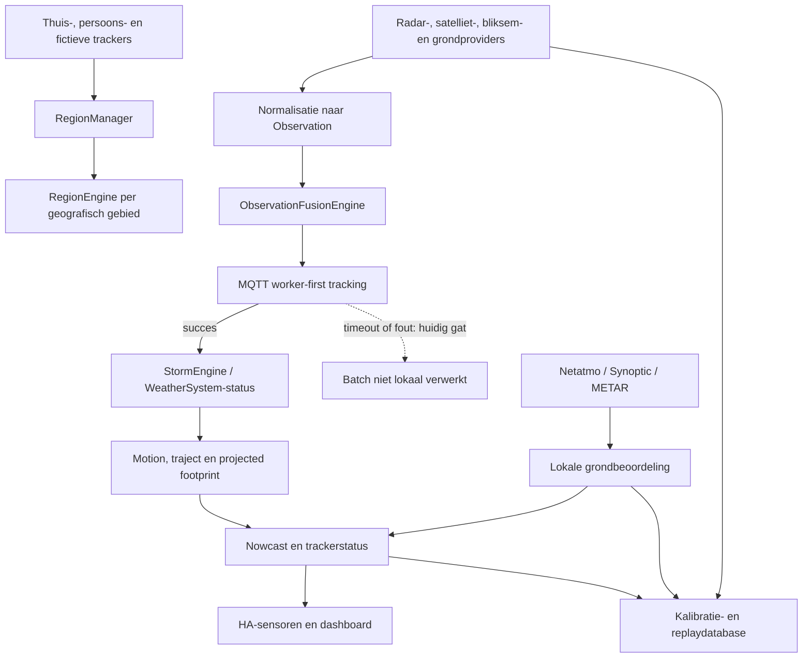

# Storm Tracker V3 — as-built en Ultra-herbeoordeling

## Documentstatus

Dit document beschrijft de actuele code in de lokale werkruimte op 29 juli
2026. Het is tegelijk:

1. een technisch as-built-overzicht;
2. een onafhankelijke herbeoordeling van de werkelijke codepaden;
3. een gatenlijst met prioriteiten;
4. een voorstel voor de wetenschappelijk betere doelarchitectuur.

Het document is bewust geen releasegoedkeuring.

| Onderdeel | Waarde |
|---|---|
| Home Assistant-integratie | `1.11.0` |
| Worker/add-on | `1.13.0` |
| Git-branch | `main` |
| Basiscommit van de werkruimte | `0c9725dbb62c6fec3997348062bcc60478ee572b` |
| Werkboom | niet schoon; dit document beschrijft ook niet-gecommitteerde bestanden |
| Auditdatum | 2026-07-29 |
| Auditmodus | read-only voor integratie en worker |
| Testresultaat tijdens deze audit | `602 passed, 1 skipped` in 16,36 s |
| Python voor test | 3.13.12 |

Belangrijke nuance: een groene unit- en contracttest-suite bewijst dat de
geprogrammeerde regels intern consistent worden uitgevoerd. Ze bewijst niet
dat die regels meteorologisch correct zijn, dat een cel dezelfde fysieke cel
blijft, of dat ETA en confidence statistisch gekalibreerd zijn.

## 1. Einduitspraak

De code bevat veel degelijk infrastructuurwerk, maar de actuele engine is nog
geen wetenschappelijk valide, celprimaire neerslagtracker.

De engine volgt hoofdzakelijk samengestelde `WeatherSystem`-objecten. De
radarcomponenten binnen zo'n systeem hebben geen blijvende identiteit over
frames heen. Groei, krimp, geboorte, uitdoving, splitsing, samensmelting en een
providerwissel kunnen daardoor ten onrechte als translatie van het hele systeem
worden geïnterpreteerd.

Daarnaast bestaan echte correctheids- en beschikbaarheidsfouten:

- trackingbatches kunnen bij workerproblemen verloren gaan;
- de Observation Fusion Engine kan een batch bij cancellation of callbackfout
  verliezen;
- vanaf vijftien actieve storms worden nieuwe echte radarcomponenten stil
  genegeerd;
- grondbevestiging wordt over alle actieve storms samen geteld en niet strikt
  voor het geselecteerde systeem;
- een tracker binnen een brede radarpolygon kan toch een positieve
  radarafstand krijgen doordat alleen naar hoekpunten wordt gemeten;
- de hard gecodeerde grens van 180 km/h bestaat nog op meerdere plaatsen;
- Synoptic-intervalneerslag kan als actuele regen worden geïnterpreteerd terwijl
  het positieve interval ouder is.

Daarom is de juiste status:

> technisch uitvoerbaar en uitgebreid getest, maar nog niet betrouwbaar genoeg
> om als definitieve meteorologische engine of als volledig opgeloste release
> te beschouwen.

## 2. Wat eerdere uitspraken corrigeert

Tijdens de herbeoordeling zijn eerdere uitspraken expliciet opnieuw getoetst.

| Eerdere indruk of uitspraak | Werkelijke toestand |
|---|---|
| Het volledige as-built-document bestond al | Onjuist. Het bestand ontbrak. Dit huidige bestand herstelt dat. |
| Hoge snelheid wordt niet meer door een vaste grens afgewezen | Onjuist. In radarassociatie, motionpreflight en het acceleratiemodel staan grenzen van 180 km/h. |
| Ground confirmation bevestigt dezelfde specifieke storm | Onjuist. Stations die aan verschillende storms gekoppeld zijn kunnen samen bevestigen. |
| Worker-first betekent geen verlies bij workeruitval | Onjuist. De lokale verwerking wordt ook bij timeout/error onderdrukt. |
| Alle echte radarcomponenten worden behouden | Onjuist. Na `MAX_STORMS = 15` worden nieuwe observaties genegeerd. |
| De database is append-only en exact herleidbaar | Slechts gedeeltelijk. Verschillende tabellen gebruiken upsert of `INSERT OR REPLACE`, en assessmentkeys verwijzen niet stabiel naar de ingestrecords. |
| 602 tests waren groen | Nu onafhankelijk bevestigd: 602 geslaagd, 1 overgeslagen. |

## 3. Functioneel doel

Het systeem probeert voor een willekeurige trackerlocatie:

- relevante neerslag boven of nabij de tracker te detecteren;
- afzonderlijke neerslagsystemen een identiteit te geven;
- positie, richting, snelheid, intensiteit en footprint bij te houden;
- de verwachte passage en ETA te bepalen;
- radar te vergelijken en te kalibreren met andere radarproducten;
- radar te toetsen aan Netatmo-, Synoptic- en METAR-grondwaarnemingen;
- de rekenlast uit Home Assistant naar een aparte worker te verplaatsen;
- voldoende ruwe en afgeleide data op te slaan voor replay en kalibratie;
- resultaten via Home Assistant-sensoren en het dashboard zichtbaar te maken.

De centrale gebruikersintentie is terecht: echt waargenomen weer mag niet
verdwijnen omdat een heuristiek het onwaarschijnlijk vindt. Onzeker bewijs mag
wel als onzeker worden gelabeld. Dat is iets anders dan het verwijderen van de
observatie.

## 4. Huidige architectuur in één stroom



## 5. Home Assistant-integratie

### 5.1 Opstart

`custom_components/storm_tracker_v3/__init__.py` is de coordinator. Die:

- bouwt providerinstanties;
- maakt de `StormManager` en `RegionManager`;
- initialiseert workercommunicatie via MQTT;
- opent de kalibratiedatabase;
- herstelt bewaarde frames, probes en auditdata;
- registreert pollingintervallen;
- koppelt trackers aan een regionale engine;
- voert providerselectie, observatierouting, opslag en sensorevents uit.

De integratie is groot en sterk gecentraliseerd. Daardoor zijn sequencing en
gedeelde `hass.data[DOMAIN]`-toestand belangrijker dan de losse providers doen
vermoeden.

### 5.2 Regionale engines

`engine/region_manager.py` groepeert trackers in regio's. Elke `RegionEngine`
bevat:

- een geografisch centrum;
- een observatieradius;
- een eigen `StormEngine`;
- een eigen `ObservationFusionEngine`;
- trackers die dat gebied gebruiken.

Dit is architecturaal zinvol. Europa en New York delen hierdoor niet één
stormlijst of één regionale motionhistorie.

De runtime gebruikt hoofdzakelijk een observatieradius van ongeveer 300 km. De
losse class-default in `region_manager.py` is 350 km, maar die is niet de
dominante effectieve runtimewaarde.

### 5.3 Polling

De volledige providercyclus draait om de vijf minuten in `_poll_all`.

De volgorde is ruwweg:

1. nationale providers;
2. radarvergelijkingen;
3. operationele radar;
4. grondmetingen en Open-Meteo;
5. virtuele probe-evaluatie;
6. Observation Fusion Engine flush;
7. verificatiesamples;
8. kalibratieopslag.

Grondpolling wordt daarnaast elke minuut gestart. `_poll_all` start eveneens
`_poll_netatmo()`. Omdat daarvoor geen eigen exclusieve grondpollock zichtbaar
is, kunnen de éénminuut- en vijfminutencyclus rond hetzelfde tijdstip
overlappen. Externe caches beperken het aantal netwerkrequests, maar interne
verwerking en diagnostics kunnen nog dubbel of concurrerend lopen.

### 5.4 Providers

De repository bevat adapters voor onder meer:

- KMI;
- KNMI;
- DWD/RADOLAN;
- Met Office;
- OPERA;
- Météo-France;
- Meteolux;
- AEMET;
- DPC;
- GeoSphere Austria;
- ItaliaMeteo;
- RainViewer;
- NOAA Enterprise Rain Rate;
- NOAA GOES RRQPE;
- HSAF H40B;
- Blitzortung;
- EUMETSAT LI;
- NOAA GOES GLM;
- Netatmo;
- Synoptic;
- METAR via de worker;
- Open-Meteo als modelcontext.

Niet iedere provider is op iedere locatie operationeel. `engine_radar_policy`
kiest per regio een bruikbare bron en houdt andere bronnen beschikbaar voor
vergelijking of fallback.

De lokale prioriteit is in grote lijnen:

1. geschikte nationale of regionale radar;
2. OPERA;
3. RainViewer;
4. NOAA Enterprise Rain Rate;
5. HSAF;
6. GOES-afgeleide neerslag.

Een lijst van beschikbare adapters is niet hetzelfde als bewezen operationele
dekking. Credentials, productbeschikbaarheid, geografische ondersteuning,
freshness en parsergezondheid bepalen de effectieve bron.

## 6. Observation-contract

`engine/observation.py` normaliseert brondata tot `Observation`.

Belangrijke velden zijn onder andere:

- `obs_type`;
- `lat`, `lon`;
- meteorologische `timestamp`;
- `received_at`;
- `source`;
- `station_id`;
- radarintensiteit;
- regenwaarden;
- `precipitation_present`;
- `quantitative_precipitation`;
- meetsoort, eenheid en interval;
- parser- en kwaliteitsinformatie;
- radarcel-, parent- en footprintinformatie.

De scheiding tussen `timestamp` en `received_at` is correct en belangrijk:

- `timestamp` zegt wanneer het weer werd waargenomen;
- `received_at` zegt wanneer Storm Tracker het ontving.

Ook het onderscheid tussen:

- “neerslag aanwezig”;
- “kwantitatief gemeten neerslag”;

is een sterk ontwerpbesluit. METAR kan bijvoorbeeld regen melden zonder een
betrouwbare mm/h-waarde te leveren.

Het contract wordt in workerstatus als observatiecontract v2 beschreven, maar
het algemene MQTT-envelopeprotocol blijft versie 1. De termen moeten in
documentatie gescheiden blijven.

## 7. Observation Fusion Engine

`engine/observation_fusion_engine.py`:

- bewaart een recente observatiebuffer;
- dedupliceert korte herhalingen;
- verzamelt nieuwe observaties in `_pending`;
- bundelt ze na ongeveer één seconde;
- levert een batch aan de regionale callback.

Sterk:

- batching voorkomt dat elke radarcel onmiddellijk een volledige trackingrun
  start;
- regenstations worden via `station_id` gededupliceerd;
- radar en bliksem gebruiken aparte observatietypes;
- de buffer ondersteunt latere context.

Kritiek gat:

1. `_deliver_pending()` kopieert `_pending`;
2. `_pending` wordt meteen leeggemaakt;
3. daarna wordt de async callback aangeroepen;
4. bij cancellation of fout wordt de batch niet teruggezet.

`async_flush_pending()` kan bovendien de normale batchtask annuleren. Als die
task de batch al uit `_pending` heeft genomen, gaat de batch verloren.

Dit is een verliesprobleem, geen gewone diagnosticafwijking.

Benodigde garantie:

- een batch blijft `pending` tot een ontvanger de verwerking bevestigt;
- cancellation of fout plaatst dezelfde batch idempotent terug;
- observaties die tijdens de callback aankomen plannen altijd een nieuwe flush;
- iedere batch krijgt een stabiele `batch_id` en volgnummer.

## 8. Radarframe en componentdetectie

Radarproducten worden naar overlays en regionale rasters omgezet. De code
probeert daarnaast de provideroverlay zonder extra regridding in de
kalibratiedatabase te bewaren.

“Origineel” betekent hier:

> de exacte interne provideroverlay die de integratie verder gebruikt.

Het betekent niet noodzakelijk:

> de oorspronkelijke bytes, metadata en projectiecontainer zoals ontvangen van
> KMI, OPERA, DWD of een andere upstream server.

De huidige componentdetectie:

- neemt natte rasterpixels boven een eenvoudige grens;
- groepeert verbonden pixels;
- kan componenten vanaf één pixel opleveren;
- maakt een component-ID met frame/tijd/componentindex;
- geeft die component door als radardetectie.

Dezelfde fysieke cel krijgt in het volgende frame doorgaans een nieuwe
providercomponent-ID. Er bestaat dus een detectie-ID, maar nog geen blijvende
`CellTrack`-ID.

Een enkele lage threshold maakt bovendien meestal een brede regenband tot één
object en onderscheidt ingebedde convectieve cores onvoldoende.

## 9. StormEngine: wat werkelijk gevolgd wordt

### 9.1 Primair object

`engine/storm.py` en `engine/storm_engine.py` modelleren een `Storm`, in de
praktijk een samengesteld `WeatherSystem`.

Zo'n object bewaart onder meer:

- een storm-ID;
- centroid;
- radar- en bliksemhistorie;
- recente radarcellen;
- systeemframes en footprints;
- heading en snelheid;
- regressie- en acceleratievelden;
- projected passage;
- confidence;
- parent- en mergevelden;
- MCS-diagnostics.

Dit is bruikbaar als bovenliggende samenvatting. Het is niet hetzelfde als
blijvende tracking van elke afzonderlijke radarcel.

### 9.2 Limiet van vijftien systemen

`MAX_STORMS = 15`.

Wanneer er vijftien niet-dormante storms bestaan en een observatie niet aan een
bestaande storm kan worden gekoppeld, logt de code dat het maximum bereikt is
en negeert de observatie.

Dat is onverenigbaar met “geen echt weer afkeuren”, vooral omdat:

- éénpixelcomponenten toegelaten zijn;
- componenten niet eerst op trackerrelevantie, oppervlakte of intensiteit
  worden gerangschikt;
- ruis of verre kleine cellen de beschikbare plaatsen kunnen innemen.

De correcte scheiding is:

- opslaglaag: alles bewaren;
- associatielaag: onzekerheid toekennen;
- rekenscheduler: relevante objecten eerst;
- dashboard: presentatie begrenzen.

Een CPU- of UI-limiet mag nooit de ingestwaarneming verwijderen.

### 9.3 Associatie

De engine vergelijkt een nieuwe observatie met bestaande storms en kiest een
nabije kandidaat wanneer `_radar_assignment_allowed()` dit toestaat.

De radarassociatie bevat een gate:

```text
toegestane afstand = 5 km + 180 km/h × verstreken tijd
```

Zowel de directe verplaatsing als de afwijking tegenover de voorspelde positie
moeten binnen die gate liggen.

Die regel beschermt tegen ID-sprongen, maar doet dit binair:

- binnen de gate: mogelijk dezelfde storm;
- buiten de gate: niet dezelfde storm.

Bij een providerwissel, split, merge, slecht centroid of ontbrekende frames kan
de fysieke bui hierdoor een nieuwe identiteit krijgen.

Een wetenschappelijk betere gate gebruikt voorspelde covariance:

- de detectie blijft altijd opgeslagen;
- de associatiekans wordt lager naarmate de Mahalanobisafstand groeit;
- bij onvoldoende bewijs ontstaat een nieuwe track zonder de observatie te
  verliezen;
- alternatieve associaties blijven voor replay traceerbaar.

### 9.4 Radaranchors

Voor systeemprestaties wordt framebeweging afgeleid uit:

- een eerste area-weighted systeemcentroid;
- daarna mutual-nearest paren tussen cellcentroids;
- de mediaan van de gevonden verschuivingen;
- een fallback naar het gewogen systeemcentroid als geen goede paren bestaan.

Dit is robuuster dan blind alleen het maximumpixel volgen, maar bewijst geen
celidentiteit. Bij groei, split, merge of geboorte kan het mutual-nearest paar
wijzigen en kan de mediaan een andere set puppies volgen dan in het vorige
frame.

### 9.5 Traject

`fit_adaptive_trajectory()` vergelijkt:

- een lineair model met constante snelheid;
- een kwadratisch model met constante versnelling.

Het versnellingsmodel wordt pas overwogen bij voldoende punten en historie en
moet een beperkte hindcast verbeteren.

Er staan alsnog harde plausibiliteitsgrenzen:

- maximale versnelling ongeveer 160 km/h²;
- toekomstige snelheid maximaal 180 km/h.

Belangrijker: `_update_movement()` berekent de adaptieve fit, maar vult de
operationele heading, snelheid en velocity opnieuw uit alleen de laatste twee
anchors. De acceleration komt wel uit de fit.

De toestand kan dus worden:

- noisy intervalvelocity uit twee frames;
- regressieversnelling uit een langere reeks.

Die combinatie is intern niet consequent. Ofwel moeten alle kinematische
componenten uit dezelfde fitted state komen, ofwel moet het tweeframe-resultaat
expliciet als aparte ruwe measurement worden gepubliceerd.

### 9.6 Split en merge

De engine bevat parent-, split- en mergevelden en probeert losse componenten
niet zomaar samen te voegen.

Toch wordt bij een merge historie van verschillende takken samengevoegd.
Gelijktijdige punten van twee fysieke cellen kunnen daarna één trajectreeks
vormen.

Een betere lineage is immutable:

- parenttrack eindigt bij split;
- childtracks starten met `parent_track_ids`;
- beide parents eindigen bij merge;
- een nieuwe mergetrack start met meerdere parent-ID's;
- historische toestanden worden nooit in één kinematische reeks
  geconverteerd.

## 10. De hondenlijnmetafoor

De eerder gebruikte metafoor is bruikbaar:

- de begeleider is de grootschalige omgevingsstroming;
- het handvat of centrale knooppunt is het `WeatherSystem`;
- de lange lijn is de globale advectie;
- de korte lijnen zijn individuele celltracks;
- de puppies zijn de cellen die lokaal groeien, krimpen, versnellen,
  vertragen, splitsen of samenkomen.

De huidige code probeert vooral de positie van het knooppunt te volgen. Als
puppies aan één kant groeien of verdwijnen, verschuift dat knooppunt zelfs
wanneer de begeleider met constante snelheid loopt.

De correcte architectuur volgt daarom eerst elke puppy als eigen track. De
beweging van het knooppunt wordt daarna als samenvatting berekend. Het knooppunt
mag nooit terug de beweging van iedere puppy overschrijven.

## 11. Waarom twee posities niet automatisch wetenschappelijk genoeg zijn

Twee correcte posities op twee correcte tijdstippen bepalen wiskundig exact:

- één verplaatsingsvector;
- één gemiddelde intervalsnelheid;
- één gemiddelde intervalrichting.

Dat is volledig correct.

Maar er zijn vier aanvullende vragen:

1. Waren beide posities werkelijk dezelfde fysieke cel?
2. Hoe groot is de positieweergavefout in elk frame?
3. Is de beweging binnen het interval constant geweest?
4. Blijft dezelfde snelheid na het tweede punt bestaan?

Zonder bewezen identiteit kan een exacte formule een exact antwoord geven op de
verkeerde correspondentie. Bijvoorbeeld:

- frame 1 gebruikt puppy A;
- puppy A dooft uit;
- frame 2 kiest puppy B;
- de berekende 189,5 km/h is exact voor A→B, maar niet de snelheid van één bui.

Daarom moet een tweepuntsnelheid worden behouden als ruwe measurement, met:

- `identity_confidence`;
- `position_covariance`;
- providerhandoffstatus;
- brede forecastonzekerheid.

Meer frames zijn geen garantie, maar kunnen identity en stabiliteit beter
toetsen.

## 12. Workerarchitectuur

De worker is een aparte Home Assistant-add-on en communiceert via MQTT.

### 12.1 Queue en CPU

De worker gebruikt:

- standaard queuegrootte 16;
- één FIFO-jobdispatcher;
- één actieve job tegelijk;
- duplicate- en deadlinecontrole;
- retained workerstatus;
- QoS 1;
- processhealth per jobtype;
- runtimeversie en codehash.

De ingestqueue behouden en iedere afzonderlijke job intern multicore laten
rekenen is technisch mogelijk, maar niet automatisch gerealiseerd door zes
CPU-threads te configureren. De jobhandler en onderliggende bibliotheek moeten
het werk werkelijk paralleliseren.

Eén actieve job is bewust gunstig voor Home Assistant-responsiviteit. Zes
rekenworkers tegelijk zouden de NUC harder belasten dan één job die intern
begrensd over meerdere cores rekent.

### 12.2 Jobtypes

De worker bevat onder meer:

- DWD/RADOLAN-fetch;
- Met Office/ODIM-fetch;
- OPERA-fetch;
- regionale radarframeverwerking;
- motionpreflight;
- operationele tracking;
- virtuele probes;
- Netatmo;
- Synoptic;
- METAR;
- NOAA Enterprise Rain Rate;
- calibratie;
- GeoJSON;
- replay- en surveyhelpers.

### 12.3 Kritiek worker-first verliespad

De regionale callback exporteert de huidige trackingstate en vraagt
`tracking_operational` aan de worker met een timeout van twaalf seconden.

Bij succes:

- de worker retourneert nieuwe snapshots;
- de lokale `StormEngine` vervangt zijn state.

Bij timeout of fout:

- diagnostic wordt `worker_onbeschikbaar`;
- `fallback_active` wordt `False`;
- de callback retourneert toch `True`.

`RegionManager` interpreteert `True` als:

> batch is verwerkt; voer `storm_engine.process_batch(scoped)` niet lokaal uit.

Daardoor kan een echte observatiebatch verdwijnen en blijft de laatste geldige
trackingstate bevroren.

Ook workervalidatiegrenzen kunnen dit activeren:

- maximaal 8000 observations per trackingjob;
- maximaal 30 startsnapshots.

Een overschrijding geeft een workerfout; het huidige HA-pad verliest daarna
dezelfde batch.

Benodigd protocol:

- iedere batch heeft `batch_id`, regio en oplopend volgnummer;
- worker retourneert een terminale status;
- alleen `completed` bevestigt verwerking;
- timeout, queue-full, invalid en failed activeren retry of lokale fallback;
- dezelfde batch mag idempotent opnieuw worden aangeboden;
- HA bewaart de batch tot een acknowledgement is verwerkt.

### 12.4 Andere workerrisico's

- Een reeds verlopen job zet de handler eerst op `working` en niet altijd terug
  op `idle`.
- Queue-full en sommige ongeldige berichten publiceren geen terminale
  jobstatus; HA wacht dan op timeout.
- Een handler zelf heeft geen harde runtimegrens of pre-emption.
- Netatmo client secret en refresh token worden als MQTT-jobpayload
  getransporteerd. Secrets horen idealiter alleen in workerconfiguratie en niet
  op het brokerbericht.
- De worker verwerkt gecomprimeerde payloads, maar volledige gzip-decompressie
  gebeurt vóór de uiteindelijke outputlimiet wordt getoetst.

## 13. Motionpreflight en pySTEPS

De huidige motionpreflight:

- gebruikt een korte reeks compatibele rasters;
- schat een globale rastertranslatie;
- vergelijkt vertalingen en centroidbeweging;
- beperkt de zoekruimte tot 180 km/h;
- gebruikt maximaal vier aangeleverde frames en evalueert een korte subset.

Dit is bruikbaar als regionale prior of kwaliteitsdiagnostic.

Het is niet geschikt om zonder meer de individuele snelheid van elke cel te
overschrijven. Een brede regenband kan de globale vector domineren terwijl een
kleine convectieve cel nabij de tracker anders beweegt.

pySTEPS is juist ontworpen rond radarvelden, optical flow, schaalafhankelijke
predictability en probabilistische ensembles. De literatuur benadrukt dat
Lagrangiaanse persistentie groei, decay en nieuwe convectie niet kan verklaren
en dat voorspelbaarheid per ruimtelijke schaal verschilt.

De beste combinatie voor Storm Tracker is:

- objecttracks voor identiteit, uitleg, split/merge en grondkoppeling;
- veldgebaseerde optical flow en ensembles voor de toekomstige
  neerslagfootprint en kans op passage.

## 14. Nowcast en trackerstatus

`engine/nowcast.py` bouwt een hoofdstatus uit:

- actuele radarafstand;
- stormafstand;
- heading en snelheid;
- projected footprintpassage;
- ETA;
- ground evidence;
- regionale motion;
- confidence;
- forecastintensiteit.

### 14.1 Polygonafstand

Op meerdere paden wordt de afstand tot footprintvertices gemeten.

Dat geeft twee fouten:

- een tracker binnen een grote polygon kan toch ver van elk hoekpunt liggen;
- een tracker buiten de polygon kan dicht bij een lijnsegment maar ver van de
  uiteinden liggen.

Correct:

1. point-in-polygon of prepared geometry;
2. bij containment is afstand exact nul;
3. anders minimumafstand tot elke polygonrand;
4. gebruik een lokale metrische projectie;
5. behoud holes en `MultiPolygon`-delen.

Dit is een sterke kandidaat voor de waarneming in New York: een brede bui hing
over de tracker, terwijl de status “mist” of geen actuele neerslag aangaf.

### 14.2 Forecastintensiteit

De huidige forecast kan het maximum van alle cellen binnen het systeem nemen.
Een zware core tientallen kilometers van de tracker kan daardoor als lokale
verwachte intensiteit verschijnen.

De intensiteit voor een tracker moet komen uit:

- de geadvecteerde pixel- of celverdeling op die tracker;
- of een ruimtelijke buurt rond de tracker;
- met een kansverdeling per lead time.

### 14.3 ETA-continuity

De continuitylaag stabiliseert springende ETA's. Bij dezelfde storm-ID kan een
plots later geworden nieuwe ETA worden vervangen door de oude countdown.

Dit maakt het dashboard rustiger, maar kan nieuw bewijs maskeren:

- systeem vertraagt;
- contour krimpt;
- passage verschuift;
- eerdere forecast was fout.

Publiceer daarom apart:

- `eta_raw`;
- `eta_filtered`;
- `eta_revision_minutes`;
- reden van filtering;
- oplopende uncertainty bij grote revisies.

### 14.4 Confidence

De confidencepercentages zijn hoofdzakelijk heuristische scores met vaste
bonussen, straffen en providergewichten.

Zonder reliabilitykalibratie betekent “80% confidence” niet aantoonbaar dat
ongeveer acht op tien vergelijkbare voorspellingen juist zijn.

Gebruik de kalibratiedatabase om per:

- provider;
- lead time;
- afstand;
- intensiteit;
- convectief of stratiform regime;
- aantal frames;
- motionkwaliteit;
- providerhandoff;

een empirische reliabilitycurve te leren.

## 15. Ground evidence

### 15.1 Bronnen

De grondlaag gebruikt:

- Netatmo;
- Synoptic;
- METAR.

Huidige freshnessvensters:

- Netatmo: 10 minuten;
- Synoptic: 20 minuten voor lokale scoring;
- METAR: 35 minuten.

Huidige basisgewichten:

- Netatmo: 0,75;
- Synoptic: 1,00;
- METAR: 0,80.

Een station moet lokaal liggen, vers zijn en—wanneer storms beschikbaar
zijn—bij een stormfootprint passen.

### 15.2 Huidige statusregels

In grote lijnen:

- minstens twee natte eligible observaties en voldoende score:
  `regen_bevestigd`;
- twee lokale natte stations, of één nat station binnen 3 km:
  `regen_waargenomen`;
- zwakker bewijs:
  `regen_aanwijzing`;
- natte stations buiten de systeemmatch:
  `natte_stations_buiten_systeem`;
- anders geen lokaal nat station of onvoldoende data.

### 15.3 Kritieke verkeerde aggregatie

De code berekent `local_raining` over alle stations die aan eender welke actieve
storm gekoppeld konden worden.

Daarna:

```text
confirmed =
    aantal local_raining >= 2
    en som quality >= 0,75
```

Er wordt niet eerst per `storm_id` gegroepeerd.

Dus dit kan gebeuren:

- station 1 is nat en matcht storm A;
- station 2 is nat en matcht storm B;
- totale score bevestigt;
- de al geselecteerde trackerforecast wordt als bevestigd en ETA 0 gemarkeerd.

Dat is logisch onjuist.

Correct:

- selecteer eerst de voorspelde `cell_track_id`;
- gebruik alleen stations die tijdspecifiek aan die trackfootprint gekoppeld
  zijn;
- bevestig alleen die track;
- publiceer los daarvan “lokale neerslag waargenomen” wanneer een ander systeem
  regen boven de tracker geeft.

### 15.4 Geen echte onafhankelijkheid

De comment zegt dat twee onafhankelijke observations vereist zijn, maar de code
controleert alleen twee records.

Er is geen:

- fysieke-site-deduplicatie;
- cross-provider herkenning;
- minimale onderlinge stationsafstand;
- ruimtelijke correlatiecorrectie;
- empirische stationbetrouwbaarheid.

Dezelfde luchthaven kan theoretisch via METAR en Synoptic dubbel meetellen.

### 15.5 Historische hull

Ground matching gebruikt bij voorkeur `storm.hull`. Die hull kan radar- en
bliksempunten van ongeveer de laatste vijftien minuten omvatten.

Een convex hull:

- vult gaten tussen cellen;
- omvat oude systeemposities;
- kan ruimte tussen losse puppies als één nat gebied behandelen.

Voor actuele bevestiging is nodig:

- de exacte `Polygon`/`MultiPolygon`-union van de actuele cellen;
- producttijd passend bij de stationtijd;
- geen historische sweepzone.

Historische footprints blijven wel nuttig voor tracking en verificatie.

### 15.6 Netatmo

Sterk:

- station-ID;
- regenpresence en capability;
- timestamps;
- source- en parsermetadata.

Gaten:

- `rain_5min = rain_60min / 12` is een afleiding, geen gemeten vijfminutenwaarde;
- de opgeslagen raw payload bevat onvoldoende originele module- en
  meetwaardedetails voor volledige parserreplay;
- quality flags beïnvloeden de ground scorer niet volledig;
- een atmosferische timestamp kan als geschatte regentimestamp gebruikt worden.

Afgeleide waarden moeten expliciet `derived=true` en een afleidingsformule
krijgen.

### 15.7 Synoptic

De worker leest `precip_intervals*` en beschouwt een positieve waarde in het
recente venster als precipitation present.

Risico's:

- een accumulatie over een afgelopen interval kan positief blijven nadat regen
  stopte;
- bij meerdere samples kan een ouder positief sample door een nieuwere
  sampletijd als actueel overkomen;
- bij geen precipsample maar wel verse temperatuur of druk kan toch een droge
  `RAIN`-observation worden gemaakt;
- de kwantitatieve intervalwaarde en exacte intervalduur worden operationeel
  onvoldoende benut.

Nodig per sensortype:

- begin- en eindtijd interval;
- accumulatieduur;
- rolling versus fixed window;
- actuele presence afgeleid van het meest relevante precipveld;
- freshness gekoppeld aan het werkelijk gebruikte preciprecord;
- raw QC/SUMMARY-data voor replay.

### 15.8 METAR

De parser gebruikt het gestructureerde `wx_string` en negeert remarks. Dat
voorkomt fouten zoals een negatie- of sensorremark die als regen wordt gelezen.

Resterende semantische gevallen:

- vicinityfenomenen zijn niet hetzelfde als regen op het station;
- `BLSN` en `DRSN` zijn opgewaaide sneeuw, niet noodzakelijk actuele
  vallende neerslag;
- METAR is categorisch en vaak ouder dan lokale radardata;
- luchthavenafstand kan groot zijn tegenover een convectieve cel.

METAR is daarom bruikbaar als corroboration, niet als exacte lokale mm/h-meter.

## 16. Kalibratie- en replaydatabase

De database staat in:

```text
.storage/storm_tracker_v3_calibration.sqlite3
```

De code gebruikt SQLite met WAL en transacties.

Belangrijke tabellen:

- `metadata`;
- `frames`;
- `frame_points`;
- `comparisons`;
- `forecast_verification_samples`;
- `pysteps_preflight_samples`;
- `system_performance_samples`;
- `pysteps_frame_cache`;
- `original_radar_frames`;
- `provider_bias_samples`;
- `provider_bias_profiles`;
- `lightning_aggregates`;
- `provider_cycle_samples`;
- `ground_observations`;
- `ground_quality_assessments`;
- `ground_confirmation_decisions`.

### 16.1 Wat goed is

- aparte database, dus niet de hoofd-HA-statehistorie;
- WAL en transacties;
- veel bron-, tijd- en regionvelden;
- aparte actuele pySTEPS-cache;
- opslag van providervergelijkingen;
- opslag van ground observations, assessments en decisions;
- pending calibratiebatches worden bij sommige opslagfouten teruggezet.

### 16.2 Niet werkelijk append-only

Voorbeelden:

- `original_radar_frames` upsert op regio, bron en nominale timestamp;
- `ground_observations` gebruikt `INSERT OR REPLACE`;
- decisions en assessments gebruiken samengestelde minuutkeys;
- meerdere evaluaties in dezelfde minuut kunnen elkaar vervangen.

De ground observationkey wordt op observed minute gebouwd, terwijl de
assessmentkey een evaluated minute gebruikt. Daardoor is de gebruikte
waarneming niet via één stabiele identity terug te linken.

Correct datamodel:

- UUID of content hash bij ingest;
- immutable `observation_record`;
- assessment bevat een foreign key naar exact dat record;
- decision bevat foreign keys naar alle assessments;
- correcties worden nieuwe versies, geen overschrijving;
- parser- en policyversie worden bij iedere beslissing opgeslagen.

### 16.3 Groei

`original_radar_frames` heeft geen retentie of quota. Dat is in lijn met de wens
om data te vergaren, maar operationeel onbegrensd.

“Alles bewaren” vereist een opslagstrategie:

- hot cache op de NUC;
- periodieke compacte archiefbestanden;
- partities per provider/datum/regio;
- controle op vrije ruimte;
- configureerbare high-water mark;
- nooit stil verwijderen;
- bij ruimtegebrek duidelijke foutstatus en exportmogelijkheid.

## 17. Sensoren en dashboard

De integratie publiceert onder meer:

- workerstatus;
- actieve radarbron;
- provider lifecycle;
- kalibratie;
- pySTEPS preflight;
- virtuele regenprobes;
- Synoptic grondmetingen;
- METAR grondmetingen;
- Netatmo stations en regen;
- neerslagstatus per tracker;
- fictieve tracker;
- stormteller;
- dichtstbijzijnde storm;
- MCS-detectie;
- region engines;
- kaart-GeoJSON.

Een technisch probleem is dat `_netatmo_target_summary()` niet alleen een
samenvatting leest. Bij sensorberekening voegt die ook quality assessments en
ground decisions toe aan pending opslaglijsten.

Een entityproperty kan door Home Assistant vaker dan verwacht worden
uitgelezen. Een readpad met writes kan daardoor:

- dubbele assessments genereren;
- pending geheugen laten groeien;
- beslissingstijd aan UI-refresh koppelen.

Beslisregistratie hoort in een expliciete evaluatiecyclus, niet in een
sensorproperty.

De dashboardlijst kan Synoptic en METAR tonen, maar zichtbaarheid is geen bewijs
dat de provider inhoudelijk bruikbare of lokale natte data leverde. Status,
healthy, heartbeat, error, stationaantal, stationafstand en observation age
moeten afzonderlijk zichtbaar blijven.

## 18. Geprioriteerde gatenlijst

### P0 — eerst oplossen

| ID | Probleem | Impact | Primair codepad |
|---|---|---|---|
| P0-1 | Workerfout retourneert toch “verwerkt” | volledige trackingbatch kan verdwijnen | `__init__.py:335-444`, `region_manager.py:161-176` |
| P0-2 | OFE wist batch vóór succesvolle callback | verlies bij cancellation/error | `observation_fusion_engine.py:110-126,164-182` |
| P0-3 | Maximaal 15 storms; nieuwe detectie genegeerd | echt weersysteem kan verdwijnen | `storm_engine.py:51,441-459` |
| P0-4 | Ground confirmation niet per storm-ID | verkeerde bui kan bevestigd worden | `sensor.py:47-60,110-143`, `netatmo_local.py:124-170` |
| P0-5 | Polygonafstand naar vertices | “mist” of afstand terwijl tracker onder bui ligt | `storm.py:600+`, `nowcast.py:408-459` |
| P0-6 | Actuele groundmatch gebruikt historische hull | oude positie of ruimte tussen cellen bevestigt | `storm_engine.py:906-938`, `netatmo_local.py:62-97` |

### P1 — hoge prioriteit

| ID | Probleem | Impact |
|---|---|---|
| P1-1 | Geen persistente CellTrack-identiteit | springen, verkeerde snelheden, geen correcte lineage |
| P1-2 | Mutual-nearest in plaats van globale associatie | split/merge/groei geeft foute correspondentie |
| P1-3 | Fitted velocity weggegooid, acceleration wel gebruikt | intern inconsistente trajectory state |
| P1-4 | Eén regionale motionvector voor meerdere storms | lokale cel krijgt beweging van ander systeem |
| P1-5 | Providerwissel onvoldoende in motionstate | productverschil wordt fysieke verplaatsing |
| P1-6 | Harde 180 km/h-gates | identiteit fragmenteert; oorzaak wordt gemaskeerd |
| P1-7 | Geen echte stationonafhankelijkheid | dubbeltelling of gecorreleerde bevestiging |
| P1-8 | Synoptic intervalsemantiek te grof | oude regen kan actueel lijken |
| P1-9 | Netatmo pseudo-5-minutenwaarde | afleiding kan als meting worden gelezen |
| P1-10 | Forecastintensiteit is systeemmaximum | verkeerde lokale intensiteit |
| P1-11 | ETA-continuity kan nieuw bewijs overschrijven | nette maar onjuiste countdown |
| P1-12 | Confidence niet empirisch gekalibreerd | percentages lijken preciezer dan ze zijn |
| P1-13 | Queue-full/invalid zonder terminal status | HA wacht onnodig op timeout |
| P1-14 | Expired job kan handler op working laten | misleidende workerhealth |
| P1-15 | Secrets in MQTT-jobpayload | onnodige credentialblootstelling |
| P1-16 | Original-frameopslag onbegrensd | NUC-opslag kan vollopen |
| P1-17 | Ground provenance niet exact | decisions niet volledig reproduceerbaar |
| P1-18 | Sensorreadpad schrijft auditrecords | duplicatie en side effects |

### P2/P3 — daarna

- gzip-outputlimiet vóór of tijdens streamingdecompressie afdwingen;
- toekomstige timestamps expliciet afwijzen of markeren;
- OFE-deduplicatie source-aware en volgorde-onafhankelijk maken;
- droge ground evidence werkelijk door de operationele pipeline sturen;
- successful refresh oude providererrors consistent laten wissen;
- exact onderscheid tussen fresh, eligible en rain-capable tonen;
- METAR vicinity en opgewaaide sneeuw semantisch scheiden;
- raw Netatmo- en Synopticpayloads vollediger opslaan;
- providerquality-fallback werkelijk met runtime-statistieken voeden;
- README- en protocolversiesynchronisatie herstellen;
- stale technische documenten markeren of vervangen;
- testartefact met versie, commit en resultaat bij iedere release bewaren.

## 19. Sterke delen die behouden moeten blijven

De herbouw hoeft niet alles weg te gooien. Waardevolle fundamenten zijn:

- regionale isolatie;
- providerregistry en geografische selectie;
- scheiding van observed time en received time;
- expliciete precipitation presence;
- onderscheid kwantitatief en categorisch;
- worker buiten het HA-hoofdproces;
- één begrensde zware-jobqueue;
- MQTT will, QoS, retained status en duplicatechecks;
- workerbuild-ID;
- SQLite WAL en transacties;
- provideroverlayopslag;
- target-specifieke sensoren;
- radarfootprints en projected passage;
- virtual probes als observerende validatielaag;
- aparte ground-, provider- en forecastaudittabellen;
- HA- en workerkopie van de kerntrackingcode die momenteel gelijk gehouden
  worden;
- uitgebreide regressietests.

Deze infrastructuur kan de nieuwe CellTrack-engine dragen.

## 20. Wetenschappelijk betere doelarchitectuur

### 20.1 Laag A — immutable ingest

Iedere bronmeasurement wordt één immutable record:

```text
ObservationRecord
  observation_id
  provider
  product
  provider_record_id
  observed_at
  interval_start
  interval_end
  received_at
  native_projection
  native_resolution
  parser_version
  calibration_version
  quality_flags
  raw_reference
  normalized_values
```

Geen hard plausibiliteitsfilter verwijdert dit record.

### 20.2 Laag B — hiërarchische detectie

Per radarframe:

- lage, providergekalibreerde threshold voor het rain shield;
- hogere thresholds voor cellen en convectieve cores;
- 8-connectiviteit waar passend;
- minimumoppervlakte in km² als qualitykenmerk, niet als delete;
- exacte `Polygon`/`MultiPolygon` met holes;
- area, centroid, perimeter, orientation;
- dBZ-percentielen en maximum;
- textuur en compactheid;
- dataquality en bronresolutie.

Kleine detecties blijven als `low_confidence_detection`.

### 20.3 Laag C — lokale motion

Bereken multiscale optical flow over meerdere opeenvolgende rasters.

Per detectie:

- lokale gemiddelde flow;
- flowspreiding;
- covariance;
- bron- en resolutieonzekerheid.

De regionale flow is:

- een prior voor jonge tracks;
- een fallback bij gaten;
- nooit een harde overschrijving van volwassen celltracks.

### 20.4 Laag D — globale associatie

Voorspel iedere bestaande cellpolygon naar het nieuwe tijdstip.

Costfuncties:

- advected intersection-over-union;
- symmetric difference;
- centroid Mahalanobis distance;
- afstand tussen polygonranden;
- Hausdorffafstand;
- area ratio;
- intensiteitsdistributie;
- orientation;
- lokale flowconsistentie;
- sourcecontinuity;
- tijdsgat.

Los de assignment globaal op met Hungarian of min-cost-flow.

Voeg expliciete nodes toe voor:

- birth;
- death;
- split;
- merge;
- temporarily missing.

Een slechte match verlaagt de waarschijnlijkheid maar verwijdert geen
detectie.

### 20.5 Laag E — CellTrack

Minimale trackstate:

```text
CellTrack
  track_id
  state = [x, y, vx, vy]
  covariance
  current_geometry
  area/intensity trends
  source history
  parent_track_ids
  child_track_ids
  lifecycle state
  identity confidence
```

Acceleration wordt pas toegevoegd wanneer langere historie dit ondersteunt.

Twee posities geven:

- voorlopige intervalvelocity;
- brede covariance;
- status `preliminary`.

Meer consistente frames geven:

- status `tracked`;
- kleinere covariance;
- beter gekalibreerde forecast.

### 20.6 Laag F — WeatherSystem

Een `WeatherSystem` groepeert actuele celltracks op basis van:

- rain-shieldconnectiviteit;
- afstand;
- coherente lokale flow;
- gedeelde evolutie;
- tijdrelatie.

Het systeem heeft:

- een aggregate footprint;
- system-level context;
- MCS-classificatie;
- een beschrijvende gemiddelde beweging.

De systeembeweging mag de individuele celstate niet overschrijven.

### 20.7 Laag G — probabilistische nowcast

Advecteer cellen en neerslagvelden als ensemble met perturbaties in:

- motionvector;
- radarpositie;
- groei en decay;
- vorm;
- providerbias;
- ontbrekende frames.

Publiceer per tracker:

- current precipitation;
- next threat;
- kandidatenlijst;
- passage probability per lead time;
- ETA p10, p50 en p90;
- verwachte lokale intensiteitsverdeling;
- raw en filtered ETA;
- bron- en modelprovenance.

### 20.8 Laag H — ground fusion

Per groundrecord:

1. capability en intervalsemantiek bepalen;
2. fysieke site dedupliceren;
3. observation time aan radar time koppelen;
4. station aan precies één actuele `cell_track_id` of aan “unmatched local
   precipitation” koppelen;
5. likelihoodbijdrage berekenen;
6. empirische betrouwbaarheid per station/provider toepassen;
7. alle bijdragen auditbaar bewaren.

Bevestiging van een forecast mag alleen wanneer de groundrecords bij exact
dezelfde geselecteerde track horen.

## 21. Herstelvolgorde

### Fase 0 — verlies stoppen

1. Worker acknowledgement correct maken.
2. Lokale fallback bij timeout/error herstellen.
3. OFE-batches bij error/cancellation terugzetten.
4. Stabiele `batch_id` en idempotent retry invoeren.
5. Queue-full en invalid terminale status laten publiceren.

### Fase 1 — actuele status correct maken

1. Point-in-polygon en edge-distance implementeren.
2. Actuele footprint scheiden van historische hull.
3. Ground confirmation per geselecteerde storm/track groeperen.
4. `current_precipitation` en `next_threat` scheiden.
5. Systeemmaximum niet meer als lokale intensiteit gebruiken.

### Fase 2 — niets meer verliezen

1. `MAX_STORMS` uit de ingestsemantiek verwijderen.
2. Alle detecties immutable bewaren.
3. Rekenen en dashboard apart prioriteren.
4. Opslagmonitor en archivering toevoegen.

### Fase 3 — metingen betrouwbaar maken

1. Synoptic-intervalvelden per sensortype interpreteren.
2. Netatmo afgeleide waarden duidelijk labelen.
3. METAR weather semantics verfijnen.
4. Fysieke groundsites dedupliceren.
5. Stabiele observation-ID's en foreign keys invoeren.

### Fase 4 — CellTrack in shadow mode

1. Hiërarchische detectie.
2. Lokale optical flow.
3. Globale assignment.
4. Immutable split/merge-lineage.
5. State en covariance.
6. WeatherSystem als secundaire groepering.

De huidige engine blijft gedurende deze fase alleen comparator, niet truth.

### Fase 5 — probabilistische nowcast

1. Ensembles.
2. Trackerpassagekansen.
3. ETA-intervallen.
4. Lokale intensiteitsverdeling.
5. Empirische confidencekalibratie.

### Fase 6 — gecontroleerde omschakeling

Omschakelen per provider/regio wanneer vooraf vastgelegde metrics aantoonbaar
beter zijn dan de huidige engine.

## 22. Validatieplan

Gebruik echte replays met bij voorkeur minstens twintig originele opeenvolgende
frames. Twintig is geen wetenschappelijke magische grens; het is een praktisch
minimum om lineage, motionstabiliteit, split/merge en providerhandoff over
langere tijd te observeren.

### 22.1 Cases

De dataset moet bevatten:

- losse kleine cel;
- brede stratiforme band;
- embedded convectieve cores;
- groeiende cel;
- uitdovende cel;
- split;
- merge;
- tijdelijk ontbrekend frame;
- providerwissel;
- bui over tracker;
- station binnen en buiten actuele footprint;
- groundstations die verschillende storms meten;
- New York/NOAA/RainViewer;
- België/KMI/OPERA;
- andere locaties en radarsystemen.

### 22.2 Trackingmetrics

- ID switches;
- fragmentation;
- track completeness;
- IDF1;
- HOTA;
- split precision/recall;
- merge precision/recall;
- position error;
- speed error;
- heading error;
- providerhandoff continuity.

### 22.3 Nowcastmetrics

- POD;
- FAR;
- CSI;
- FSS;
- Brier score;
- reliability diagram;
- ETA MAE;
- ETA bias;
- p10/p90 intervalcoverage;
- lokale intensiteitsfout;
- performance per lead time.

### 22.4 Operationele metrics

- ontvangen observations;
- persistent opgeslagen observations;
- aangeboden batches;
- acknowledged batches;
- retries;
- lokaal gefallbackte batches;
- verloren batches, die altijd nul moeten zijn;
- worker queue age;
- job runtime;
- NUC CPU-temperatuur;
- HA event-loop latency;
- databasegroei per dag.

### 22.5 Acceptatie

Geen enkele release mag alleen op “tests groen” worden goedgekeurd.

Minimaal nodig:

- unit- en contracttests groen;
- geen batchverlies onder geforceerde timeout, queue-full en workerrestart;
- polygoncontainmenttests;
- cross-storm groundtests;
- replaymetrics beter dan de huidige baseline;
- betrouwbaarheidsplots zonder zware overconfidence;
- storage soaktest;
- HA-responsiviteit onder pieklast.

## 23. Nog ontbrekende tests

De huidige 602 groene tests dekken niet afdoende:

- cancellation nadat `_pending` al is leeggemaakt;
- worker timeout met verplichte lokale fallback;
- queue-full met terminale status;
- expired job die handlerhealth herstelt;
- twee natte stations bij twee verschillende storms;
- dezelfde fysieke site via METAR en Synoptic;
- tracker binnen brede polygon;
- afstand tot polygonsegment;
- historische hull versus actuele footprint;
- vijftien ruisstorms gevolgd door een relevante bui;
- providerhandoff zonder valse snelheid;
- split/merge lineage op echte rasterreplays;
- calibration van confidencepercentages.

Groene tests kunnen een foute regel vastleggen. Zo bestaan tests die de huidige
hard-speed rejection en `MAX_STORMS` expliciet als verwacht gedrag behandelen.

## 24. Wetenschappelijke basis

De aanbevolen hybride aanpak sluit aan bij primaire literatuur:

- [Pulkkinen et al. (2019), pySTEPS](https://gmd.copernicus.org/articles/12/4185/2019/)
  beschrijft optical flow, advection, schaalafhankelijke predictability en
  probabilistische ensemble-nowcasting. De auteurs benoemen groei, decay en
  initiatie als belangrijke beperkingen van Lagrangiaanse persistentie.
- [Cell-TAO (2023)](https://gmd.copernicus.org/articles/16/851/2023/)
  laat zien dat celdefinitie en split/merge-keuzes de resulterende
  trackstatistiek materieel beïnvloeden.
- [Object-based and Lagrangian hailstorm analysis (2025)](https://wcd.copernicus.org/articles/6/645/2025/)
  onderstreept het nut van object- en Lagrangiaanse analyse naast
  veldgebaseerde ensemble-informatie.
- [TITAN, Dixon & Wiener](https://impacts.ucar.edu/en/publications/titan-thunderstorm-identification-tracking-analysis-and-nowcastin/)
  is een klassieke basis voor stormidentificatie, tracking, split/merge en
  nowcasting.

Deze bronnen betekenen niet dat Storm Tracker een volledig operationeel
weermodel moet kopiëren. Ze ondersteunen wel de centrale ontwerpkeuze:

> veldmotion voor neerslagextrapolatie, persistente objecttracks voor identiteit
> en lineage, en probabilistische output voor onzekerheid.

## 25. Vragen voor een externe verificatie

Een externe reviewer kan dit document en de code toetsen met minstens deze
vragen:

1. Kan een observationbatch in elk error- en cancellationpad exact één keer
   worden verwerkt?
2. Kan een echte radardetectie ooit verdwijnen wegens een capaciteit- of
   plausibiliteitslimiet?
3. Bestaat er een blijvende identity per fysieke cel?
4. Is iedere split en merge als immutable lineage terug te volgen?
5. Komt velocity en acceleration uit één consistente state-estimator?
6. Wordt providerhandoff als measurement discontinuity behandeld?
7. Is actuele polygonafstand geometrisch correct?
8. Is ground confirmation strikt gekoppeld aan dezelfde geselecteerde track?
9. Zijn twee stations werkelijk fysiek onafhankelijk?
10. Is iedere decision via foreign keys tot de gebruikte raw records te
    herleiden?
11. Heeft ieder confidencepercentage een empirische reliabilitybetekenis?
12. Kunnen CPU-, queue- en dashboardlimieten de ingestdata nooit verwijderen?
13. Zijn `current precipitation` en `next threat` afzonderlijke contracten?
14. Zijn ETA en intensiteit lokaal op de tracker berekend?
15. Bewijzen replays verbetering op identity, ETA, passage en calibration?

## 26. Definitieve aanbeveling

Niet alle veiligheidsremmen moeten blind worden verwijderd.

Wel moet het systeem dit onderscheid afdwingen:

- **observatie:** altijd bewaren;
- **detectie:** altijd registreerbaar, ook bij lage quality;
- **associatie:** mag onzeker of afgewezen zijn, maar met reden en alternatieven;
- **track:** krijgt probability en covariance;
- **forecast:** krijgt een kansverdeling;
- **dashboard:** mag prioriteren;
- **CPU-scheduler:** mag werk uitstellen;
- **geen van beide laatste lagen mag het weerrecord wissen.**

De kernkoers is:

> alles bewaren, niets blind bevestigen, individuele cellen persistent volgen,
> split/merge expliciet modelleren, WeatherSystem alleen als bovenliggende
> groepering gebruiken en trackerforecast probabilistisch valideren.

